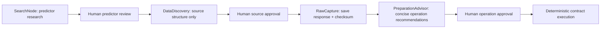

# Workflow Architecture

For the user-facing four-stage sequence, see
[`end-to-end-workflow.md`](end-to-end-workflow.md).

## Design boundary

LangGraph orchestrates a stateful data workflow; it does not replace data engineering. Retrieval, parsing, transformations, validation, evidence selection, numeric rendering, and report verification are deterministic Python. The optional LLM receives only a reduced qualitative view of validated evidence and can write prose, but cannot retrieve data, calculate indicators, add numbers, or override a failed gate.

The governed onboarding path is separate from normal production execution:

Project memory is available from the first research stage. Only confirmed decisions enter
later prompts; pending questions remain visible but cannot authorize an operation.

```mermaid
flowchart LR
    A[Load catalogue] --> B[Initialize immutable run]
    B --> C{Execution mode}
    C -->|live| D[Retrieve official sources]
    C -->|snapshots| E[Copy preserved snapshots]
    D --> F[Checkpoint raw evidence]
    E --> F
    F --> G[Normalize]
    G --> H[Transform]
    H --> I[Validate quality and as-of rules]
    I -->|fail| J[Persist diagnostics and halt]
    I -->|pass| K[Build evidence bundle]
    K --> L[Writer]
    L --> M[Compose numeric evidence]
    M --> N[Deterministic verifier]
    N -->|bounded revision| L
    N -->|pass| O[Persist final artifacts]
    N -->|max revisions| J
```

## Node responsibilities

| Node | Responsibility | Failure behavior |
|---|---|---|
| `load_catalog` | Load official URLs, exact labels, units, mechanisms, and freshness rules | Invalid catalogue stops the run |
| `retrieve_sources` | Serial HTTP retrieval, pagination, retry, raw preservation, SHA-256 | Required failure blocks reporting; optional cached reuse must be explicit |
| `discover_snapshots` | Copy one preserved official snapshot per source into the new run | Missing snapshot blocks reporting |
| `normalize` | Parse data.gov.sg long/wide layouts and the MOM final report | Unknown schema, label, number, or report wording fails closed |
| `transform` | Compute calendar-aligned index changes, vacancy, pipeline metrics, SORA quarter-end values, and GDP changes | Missing comparison periods are not bridged; zero denominators and invalid inputs produce persisted validation errors |
| `validate` | Enforce coverage, units, periods, duplicates, history length, freshness, and cut-off | Schema drift is flagged for human review |
| `build_evidence` | Whitelist reportable metrics and attach mechanism plus provenance | Intermediate calculation rows are excluded |
| `writer` | Produce separate shared, rental, and sale qualitative sections | Missing credentials or invocation failures halt cleanly |
| `compose_report` | Render deterministic numeric evidence and claim ledger | LLM never controls quantitative statements |
| `verify_report` | Match value/unit/period/URL, disclosures, section semantics, and language rules | At most the configured number of revisions, then halt |

## State, checkpoints, and terminal status

`AgentState` contains run identity, information cut-off, source catalogue, run-local raw paths, normalized and derived observations, validation output, evidence, writer metadata, claim ledger, and verifier output. Checkpoints after retrieval, normalization, transformation, and validation allow a running job to resume without repeating successful upstream work, including continuing report generation from a validated checkpoint.

Terminal status is `complete` when all official sources and checks pass, `partial` when an explicitly approved cached official snapshot was required, and `failed` when a required source, quality gate, writer, or verifier fails. Failed runs preserve diagnostics and raw evidence but do not fabricate a report.

## Writer and verifier contract

The default deterministic writer makes the project runnable without credentials. The optional OpenAI writer is selected by command-line configuration through LangChain. Both return the same structured output shape with writer type, model, prompt version, token usage when available, and UTC response timestamp.

The composer owns all report numbers. Each numeric bullet has a claim ID linked to one evidence metric. The verifier rejects unledgered numbers, mismatched values/units/periods/URLs, unsupported citations, missing incomplete-quarter disclosures, population/employment confusion, sale/rent mechanism leakage, causal language, and forecasts.

## Key design decisions

1. Official-source retrieval is allowlisted; normal runs do not perform open web search.
2. Raw bytes are saved before parsing and tied to SHA-256 checksums.
3. Snapshot mode copies evidence into the new run rather than pointing to mutable external files.
4. Annual population is not interpolated, and quarterly employment change is not relabelled as population.
5. Values whose source period ends after the reporting cut-off are excluded.
6. Historical point-in-time claims remain limited where providers do not expose archived release vintages.
