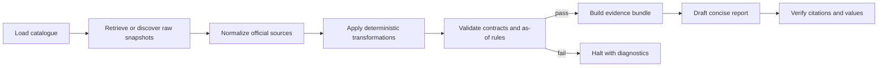

# Workflow Architecture

## Why LangGraph

LangGraph is used as a stateful orchestration layer, not as a substitute for data engineering. Retrieval, parsing, transformations, and validation are deterministic Python nodes. This makes every reported number reproducible and testable. An LLM may later rewrite the validated evidence brief for readability, but it is not permitted to fetch hidden data, calculate indicators, choose unverified values, or override a failed validation.

## Node responsibilities

| Node | Input and output | Reliability boundary |
|---|---|---|
| `load_catalog` | Loads source definitions and exact series-selection rules | Fails on an invalid or missing catalogue |
| `discover_snapshots` | Resolves the newest preserved raw response per source | Does not invent or silently substitute a source |
| `normalize` | Converts the two official JSON layouts and the MOM report into one observation schema | Rejects ambiguous numerics and unexpected report wording; applies the reporting cut-off |
| `transform` | Computes benchmark changes, vacancy, pipeline share, quarterly SORA selection, and GDP changes | Pure calculations; no LLM calls |
| `validate` | Checks required-source coverage and duplicate series-period keys | Routes failures to `halt` |
| `build_evidence` | Selects latest validated observations for each series | Keeps value, unit, period, and source-period context together |
| `draft_report` | Produces the evidence brief | Currently deterministic; optional LLM rewriting must consume only the evidence bundle |

## State and branching

`WorkflowState` carries the reporting cut-off, catalogue, raw paths, normalized observations, derived observations, validation errors, evidence, and report text. The graph has one conditional branch: after validation, a clean state proceeds to evidence construction; any error halts report generation. This prevents a polished narrative from hiding missing or invalid source data.

## LLM boundary

If an LLM node is added, its prompt will contain a compact JSON evidence bundle and explicit constraints: preserve all values and units, distinguish sale and rent mechanisms, state data limitations, make no causal or forecast claim, and cite only the supplied official URLs. Its output will be checked against the evidence bundle before publication. The workflow remains useful without an API key because the deterministic Markdown report is the default.

