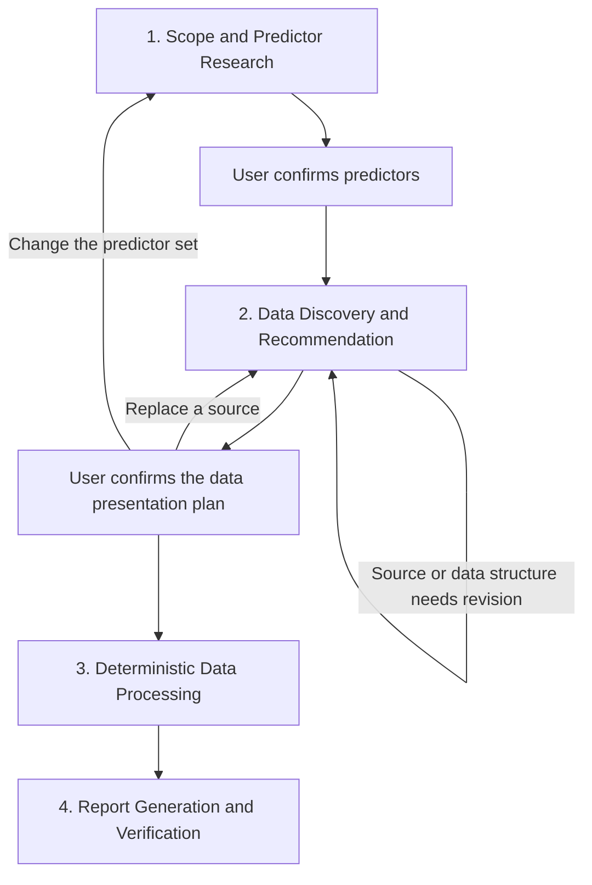

# End-to-End Workflow

## Purpose

This workflow helps a user move from a research question to a reproducible analytical
report on Singapore residential sale prices and rents. The user-facing process has four
stages:

1. define the scope and select predictors;
2. discover, retrieve, understand, and review the data;
3. process and validate the approved data;
4. generate and verify the report.

Internal capabilities such as project memory, checkpoints, provider adapters, and audit
manifests support these stages but are not separate user tasks.

The repository exposes two related paths. The **interactive Agent Flow** covers research,
source discovery, mapping and preparation recommendations, with human approval before the
predictor portfolio and data plan are frozen. The **reviewer reproduction flow** starts from
the approved `FrozenDataPlan` and preserved raw snapshots, then runs deterministic Stage 3
and evidence-bound Stage 4 without network access or an API key. The second path is the
submitted demonstration; it does not replace the earlier agent-assisted stages.

## Current Implementation Map

The four stages describe the user experience. Adaptive onboarding freezes a typed plan that
the deterministic processor consumes directly, and Stage 4 consumes the resulting validated
evidence bundle. The implemented components support the complete governed flow, while the
reviewer-facing command deliberately begins after the two human approvals so that the
submitted result can be reproduced offline from fixed inputs.

| Workflow capability | Current implementation | Status |
|---|---|---|
| Scope-aware literature and predictor research | `PredictorSearchNode` | Implemented and tested |
| Human predictor selection and rationale | `PredictorReviewNode` | Implemented and tested |
| Official-source discovery and deterministic endpoint probe | `DataDiscoveryNode` | Implemented and tested |
| Raw response preservation and profiling | Reusable unmapped capture plus `SchemaProfiler` | Implemented and tested for JSON, CSV, and Excel |
| Data inventory table and preparation recommendation | `DataPreparationAdvisorNode` | Implemented and accepts validated full-snapshot mapping evidence |
| Reviewer reproduction from approved snapshots | `run_submission_pipeline.py` | Implemented and tested end to end |
| Adaptive schema mapping and recovery for previously unseen sources | `AdaptiveMappingNode` | Implemented; repair bounded to three attempts |
| Unified source, mapping, and preparation review | `UnifiedPlanReviewNode` | Implemented and tested as one approval boundary |
| Adaptive onboarding handoff to deterministic processing | `FrozenDataPlan` → Stage 3 | Implemented and tested |
| Evidence-bound report generation and verification | `ValidatedEvidenceBundle` → Stage 4 LangGraph | Implemented and tested |

## Workflow Overview



The submitted reviewer path is intentionally narrower:

```text
FrozenDataPlan + preserved raw snapshots
→ Stage 3 deterministic processing
→ ValidatedEvidenceBundle
→ Stage 4 composition and verification
→ verified final report
```

Run it with:

```bash
.venv/bin/python scripts/run_submission_pipeline.py \
  --output outputs/submission_run \
  --print-report
```

## 1. Scope and Predictor Research

### User input

Before literature research begins, the workflow confirms the parts of the scope that affect
what evidence and data are eligible:

- geography, normally Singapore;
- housing segment, such as private residential, public housing, or both;
- market, such as sale, rent, or both;
- the reporting **as-of date**;
- any required predictor categories or exclusions;
- the intended purpose of the report.

The reporting as-of date must be confirmed at the beginning. It determines which literature,
source releases, and observations the workflow is allowed to use. For example, a report with
an as-of date of 30 June 2026 must not use a July 2026 observation merely because the workflow
is run later.

The exact historical analysis window does not need to be fixed at this point. Before seeing
the real coverage of the selected data, the workflow cannot know the most defensible common
start date.

### Predictor research

After receiving the scope, the Predictor Search stage:

- searches academic literature and relevant official research;
- identifies potentially informative macroeconomic, financial, demographic, and
  market-level factors;
- distinguishes shared, sale-specific, and rent-specific mechanisms;
- provides citations and concise theoretical explanations;
- recommends a small predictor set within the approved scope.

### User decision

The user may:

- approve the recommended predictors;
- remove a predictor;
- request another predictor;
- change the housing or market scope;
- ask for further literature support.

This stage ends only when the predictor set is confirmed.

### Stage output

- confirmed research scope;
- confirmed reporting as-of date;
- approved predictors;
- literature evidence and predictor-selection rationale.

### Implemented node contract: PredictorSearchNode

The current `PredictorSearchNode` is the implemented entry point for Stage 1. It is an
isolated LangGraph node rather than a general-purpose chat agent.

#### Inputs

| Input | Purpose |
|---|---|
| User research request | Describes the question the user wants the workflow to investigate |
| Approved scope | Fixes geography, housing segment, market, categories, channels, and reporting as-of date |
| Confirmed project memory | Carries previously confirmed preferences and decisions without treating pending statements as approval |
| Provider and search budget | Selects a supported LLM/search adapter and bounds external search calls |

The node supports provider-specific research adapters for Gemini, OpenAI, Anthropic, and
DeepSeek. Provider credentials are read from environment variables and are not written to
project artifacts.

#### Execution

The node:

1. checks that the requested scope agrees with confirmed project memory;
2. constructs a scope-specific research prompt;
3. searches academic literature and relevant official reports;
4. requests one or two candidate concepts per requested category;
5. separates sale, rent, and shared mechanisms;
6. records the evidence supporting every proposed mechanism;
7. records a data requirement for later source discovery without inventing an endpoint or
   production transformation;
8. returns a typed research proposal;
9. applies deterministic hard gates and scoring;
10. renders a concise academic summary for human review.

#### Structured output

Each proposed predictor includes:

- predictor ID and name;
- macroeconomic, financial, demographic, or market-level category;
- sale, rent, or shared role;
- theoretical mechanism for each claimed market;
- literature or official-report evidence references;
- evidence-strength and relevance assessment;
- preferred and acceptable source frequencies;
- preferred unit and likely official agencies;
- required historical coverage and source-search hints;
- known limitations and unresolved questions.

The research output intentionally does **not** contain an API endpoint, raw-data mapping,
aggregation method, change calculation, lag, or missing-value rule. Those decisions require
real source inspection in Stage 2.

#### Deterministic validation

The node checks that:

- the proposal remains inside the approved geography, housing, and market scope;
- requested predictor categories are covered or explicitly disclosed as missing;
- no category contains more than the permitted number of candidates;
- every evidence reference resolves to a cited source;
- source dates comply with the reporting as-of rule or are labelled method-only evidence;
- shared predictors contain distinct sale and rent mechanisms;
- annual concepts are not misrepresented as timely short-run predictors;
- strong evidence ratings are not accepted without independent support;
- operational data transformations have not leaked into the research proposal.

Validation failure produces reviewable diagnostics and prevents predictor approval. The LLM
cannot waive a failed deterministic gate.

#### Human interaction and stopping point

The node ends with `human_review=pending`. The user reviews the literature summary and may
approve, reject, or request revision for each predictor. Only approved predictors and the
human's selection rationale enter confirmed project memory and Stage 2.

#### Persisted artifacts

The run preserves:

- typed research proposal;
- academic human-readable summary;
- search-query and evidence trace;
- deterministic validation and scoring;
- provider metadata and bounded raw provider response;
- compiled memory snapshot and checksum manifest;
- error diagnostics when the run fails.

#### Current verified behaviour

Automated tests cover all supported provider contracts, invalid scope, missing credentials,
search-budget validation, citation integrity, category and market rules, as-of handling,
memory consistency, raw-response preservation, and the isolated LangGraph execution path.

#### Current command

```bash
.venv/bin/python scripts/run_research_search.py \
  --provider gemini \
  --request "Identify literature-supported predictors for Singapore private residential sale prices and rents." \
  --scope config/research_scope.example.json \
  --output outputs/research_search_review \
  --print-summary
```

The same command can use another configured SearchNode provider. The output directory keeps
the structured proposal, validation, provider trace, human-readable summary, and memory
manifest even when the run fails.

## 2. Data Discovery and Recommendation

This stage begins only after the predictor set has been confirmed. It combines flexible
source discovery with verified raw-data evidence.

### 2.1 Find public data

For every approved predictor and every required sale or rental outcome, the workflow:

- searches official Singapore government and statutory-board sources;
- identifies a source page and a machine-readable retrieval method where available;
- considers official API, JSON, CSV, Excel, and documented report formats;
- checks that the source definition matches the approved predictor concept;
- records alternative official sources when useful.

### 2.2 Download and preserve raw data

The workflow then retrieves the candidate data and preserves enough evidence to reproduce
the analysis:

- raw response or downloaded file;
- retrieval URL and request parameters;
- retrieval timestamp;
- file format and content type;
- byte count;
- SHA-256 checksum;
- source and series identifiers.

The raw snapshot is never modified. Later processing creates separate derived artifacts.

### 2.3 Learn and validate the data structure

The workflow inspects the downloaded raw data to identify:

- where the observation records are located;
- the exact series label;
- date and value fields;
- long, wide, nested, or document-based layout;
- date format;
- missing-value markers;
- definition and unit;
- observation frequency;
- official update frequency;
- observed coverage and non-null observation count.

A proposed mapping is executed against the raw snapshot. The workflow compares the raw and
parsed record counts, checks dates and values, and identifies duplicate or invalid periods.
If the initial mapping fails, the system may repair the mapping, try another official format
for the same dataset, or search for another suitable official source. A different definition
or predictor cannot be substituted without user approval.

### 2.4 Recommend the data presentation plan

Once the source and structure are validated, the workflow presents the agreed concise review
format. It starts with one table covering every predictor and outcome:

| Series | Public source | Raw snapshot | Definition | Unit | Observation frequency | Update frequency | Raw coverage | Validation | Recommended treatment |
|---|---|---|---|---|---|---|---|---|---|
| Example series | Official source | Saved | Official definition | Published unit | Monthly | Monthly | Actual raw coverage | Pass | Recommended comparison and change method |

The table is followed by:

- a checklist confirming that raw evidence, definitions, units, observation frequencies,
  and update frequencies have been retained;
- a concise overall recommendation;
- short series-level recommendations where needed;
- any limitations that affect interpretation;
- user review options and a free-text instruction field.

Recommendations may cover:

- whether to retain a native monthly, quarterly, or annual view;
- whether a monthly series should also have a quarterly mean, last, or sum view;
- whether to calculate MoM, QoQ, or YoY changes;
- whether a change should use an absolute amount, percentage, percentage point, or basis
  point;
- whether a lagged exploratory view is useful;
- whether the series is primarily relevant to sale, rent, or both;
- which series should be compared on a common quarterly basis.

### 2.5 Confirm time coverage and presentation

At this point the workflow has seen the real coverage of every series. It can therefore
recommend an analytical window, such as:

- the longest common eligible period;
- a shorter recent period for the main report;
- full native history in the appendix;
- exclusion of observations unavailable by the reporting as-of date.

The user now confirms both the historical analysis window and the desired data presentation
plan. The user may:

- approve all recommendations;
- modify transformations or change calculations;
- choose another historical window;
- request native-frequency and quarterly views together;
- replace a data source;
- provide free-text preparation instructions;
- change the predictor set;
- reject the proposal.

Any requested modification is restated as an explicit before-and-after change and requires
confirmation before execution.

### Stage output

The confirmed data plan contains:

- approved sources;
- preserved raw snapshots;
- approved schema mappings;
- approved definitions, units, and frequencies;
- confirmed historical analysis window;
- approved aggregation, change, lag, and missing-value rules;
- user decisions and reasons.

### Implemented source-discovery bridge

The current `DataDiscoveryNode` receives one human-approved predictor at a time. It searches
for one or two official Singapore sources, proposes the source page and machine retrieval
URL, records structural metadata, and independently probes each URL. A hard-gate score
combines official authority, successful access, schema match, frequency suitability,
machine readability, and point-in-time documentation. Failed probes cannot be promoted to a
catalog entry.

This node proposes source candidates and enough structure for an independent access probe.
After source approval, reusable raw capture, adaptive mapping, and full-snapshot validation
run before preparation advice and the unified data-plan review.

### Implemented node contract: DataPreparationAdvisorNode

The `DataPreparationAdvisorNode` produces the table-first, concise recommendation format.
It can now reuse preserved snapshots and validated mapping executions, so its coverage and
missingness evidence comes from the complete mapped snapshot rather than a guessed preview.

#### Inputs

| Input | Purpose |
|---|---|
| Confirmed project memory | Supplies scope, as-of date, predictor rationale, and reporting preferences |
| Approved source profiles | Supply official URL, exact series label, definition, unit, frequencies, and structural mapping |
| Predictor and market roles | Distinguish shared, sale-focused, and rent-focused use |
| Output directory | Provides the durable location for raw snapshots and review artifacts |

#### Raw-first execution

Before the LLM is called, deterministic code either reuses an approved preserved snapshot
or captures the approved source response, then:

1. identifies the approved snapshot and retrieval metadata;
2. verifies the URL against the official-source allowlist;
3. saves the unmodified response bytes;
4. records retrieval time, HTTP status, content type, and byte count;
5. calculates a SHA-256 checksum;
6. selects the approved series from the response;
7. extracts a three-observation preview;
8. profiles actual observed coverage and non-null observation count;
9. stops before recommendation if any raw snapshot cannot be saved or inspected.

#### Human-facing output

The node begins with one consolidated inventory table containing:

- series and intended market use;
- public source and link;
- raw-snapshot status;
- official definition;
- published unit;
- observation frequency;
- update frequency;
- observed raw coverage;
- source-level validation status;
- recommended transformation.

The table is followed by the assignment checklist, one concise recommendation, five review
choices, and a free-text instruction prompt. The five choices are:

1. approve all recommendations;
2. approve sources but modify transformations;
3. replace one or more data sources;
4. provide custom preparation instructions;
5. reject the proposal.

#### Recommendation contract

For every source, the LLM proposes a typed preparation contract covering:

- preservation of native observations;
- an optional monthly-to-quarterly comparison view;
- `last`, `mean`, or `sum` aggregation when semantically allowed;
- explicit change calculations and calendar lags;
- optional exploratory predictive alignment;
- missing-value and interpolation restrictions;
- rationale, alternatives, limitations, and decision-basis references.

The deterministic validator rejects invalid operations. Examples include summing a rate or
index, assigning a quarterly aggregation to non-monthly input, using basis-point changes on
a non-rate series, applying an incorrect calendar lag, interpolating annual data, or citing
unknown memory events and source profiles.

#### Human interaction and stopping point

The recommendation always stops for human review. A review remains a draft until the user
explicitly confirms it. In the governed end-to-end path, source identity, mapping, and the
preparation contract are presented at one unified approval boundary. Approval triggers
deterministic revalidation, plan versioning, `FrozenDataPlan` creation, and a confirmed
project-memory event. No numerical processing is performed by the LLM.

Custom instructions can be recorded and reflected in an edited typed contract. They do not
take effect until the revised contract has been shown to the user, validated, and explicitly
approved.

#### Persisted artifacts

The current Advisor preserves:

- raw response files under the run output directory;
- raw-snapshot evidence, preview, coverage, and checksum;
- typed preparation proposal;
- deterministic contract validation;
- human-readable Markdown review;
- provider metadata and bounded raw response;
- review submission and result;
- approved preparation plan after confirmation;
- project-memory approval event.

#### Implemented adaptive sequence and operational boundary

The Stage 2 sequence is:

```text
Source discovery
→ raw capture
→ adaptive schema mapping
→ deterministic mapping validation and recovery
→ data-plan recommendation
→ one unified human review
→ freeze source, mapping, and preparation contracts
```

JSON, CSV, and Excel profiling, invalid-mapping repair, unified freezing, and direct Stage 3
handoff are covered by offline tests. The submitted complete portfolio uses the preserved,
approved snapshots so that it remains reproducible. A new live retrieval is treated as an
operational run: changed content or structure must pass the same validation and may reopen
the relevant human approval. Automatic switching to another official representation after
three failed mapping attempts is not performed silently; the current router returns a
source-replacement decision to the user.

#### Current command

```bash
.venv/bin/python scripts/run_preparation_advisor.py \
  --catalog-fragment outputs/sora_catalog_review_3/approved_catalog_fragment.json \
  --raw-snapshot-evidence outputs/raw_portfolio/raw_snapshot_evidence.json \
  --mapping-result outputs/sora_mapping/adaptive_mapping_result.json \
  --output outputs/preparation_review \
  --print-summary
```

The command saves raw files under `outputs/preparation_review/raw/` and prints the
human-facing inventory and recommendation when raw capture, LLM generation, and
deterministic validation all pass. It is an interactive-stage command and therefore requires
a configured provider; it is not needed for the offline reviewer reproduction path.

## 3. Deterministic Data Processing

After the user confirms the data plan, processing is deterministic. The LLM does not
calculate, edit, or invent numerical observations.

### 3.1 Normalize

The workflow applies the approved mapping to the preserved raw snapshot and emits a common
observation structure containing:

- source and series identifiers;
- period and value;
- definition and unit;
- observation and update frequency;
- sale, rent, or shared role;
- reporting-as-of eligibility;
- raw snapshot checksum and raw-record lineage.

### 3.2 Validate each series

The workflow checks:

- required fields and valid numeric values;
- duplicate and invalid periods;
- calendar continuity;
- missing observations;
- unit and frequency consistency;
- incomplete periods;
- release availability at the reporting as-of date;
- reconciliation between raw and normalized observations.

### 3.3 Transform

Only approved operations are executed, for example:

- monthly-to-quarterly aggregation;
- absolute, percentage, percentage-point, or basis-point changes;
- MoM, QoQ, and YoY calculations;
- explicitly approved exploratory lags.

Native observations are retained. Missing values are not changed to zero, annual data are
not artificially interpolated to quarterly frequency, and missing calendar periods are not
silently bridged.

### 3.4 Validate the combined dataset

After transformation, the workflow checks:

- actual common coverage across outcomes and predictors;
- predictor–outcome period alignment;
- incomplete latest quarters;
- data freshness;
- usable observation counts;
- duplicated or highly overlapping predictors;
- consistency with the confirmed analysis window and reporting as-of date.

Hard validation failures stop report generation and preserve diagnostics for correction.

### Stage output

- normalized observations;
- transformed observations and calculated changes;
- lineage and execution traces;
- per-series and cross-series validation results;
- a validated evidence bundle for reporting.

## 4. Report Generation and Verification

The final report is generated from the validated evidence bundle as part of the same
workflow.

### 4.1 Build report evidence

The workflow selects reportable results and attaches:

- value, period, unit, and change method;
- predictor mechanism and market role;
- official source and raw lineage;
- limitations and as-of disclosures.

The deterministic selector takes the latest eligible non-null observation for every
reportable series. Predictive-lag views are excluded from the current-condition report
because their displayed period is an outcome-alignment period rather than the original
source period. Approved levels, quarterly comparison views, and changes remain distinct
ledgered claims.

### 4.2 Write the report

The LLM may organise and explain the validated evidence, distinguish sale and rental
mechanisms, and produce concise qualitative interpretation. It cannot calculate new values,
alter deterministic results, or introduce unsupported quantitative claims.

The report writer receives a generated prompt containing the confirmed scope, objective,
and structured evidence cards. Each card includes a claim anchor, validated value, period,
unit, direction, derivation, predictor rationale, permitted literature identifiers, and
data-quality notes. The writer may decide how to organise and interpret this evidence, but
it must represent quantitative evidence through the supplied anchors rather than typing or
altering the numerical statements. Deterministic code resolves those anchors and renders
the final values, units, periods, sources, and citations. Gemini, OpenAI, Anthropic,
DeepSeek, Groq, and Ollama writers share this contract; a deterministic no-key writer is the
reproducible default.

### 4.3 Verify the report

Deterministic checks verify:

- every number against the evidence bundle;
- units and periods;
- source references;
- sale and rent distinctions;
- incomplete-period and as-of disclosures;
- unsupported causal, predictive, or forecasting language.

The workflow permits only bounded report revisions. If verification still fails, it returns
diagnostics rather than an unverified report.

The writer, composer, verifier, and revision router are compiled as a LangGraph subgraph.
Each run preserves the exact final prompt, prompt and evidence checksums, claim ledger,
writer metadata, verification result, and final or blocked report. Revision is capped at
three attempts.

### Stage output

- final concise analytical report;
- selected evidence and source register;
- claim ledger;
- report-verification result, prompt manifest, writer metadata, and run manifest.

### Current command

After Stage 3 has produced its evidence bundle:

```bash
.venv/bin/python scripts/run_stage4_report.py \
  --evidence outputs/stage3/evidence/validated_evidence_bundle.json \
  --brief config/report_brief.example.json \
  --output outputs/stage4 \
  --provider deterministic \
  --print-report
```

To carry confirmed context forward automatically, also pass the compiled project-memory
snapshot and the approved frozen plan:

```bash
  --memory outputs/project_memory/memory_vN.json \
  --plan outputs/unified_review/frozen_data_plan.json
```

The frozen plan maps approved predictor IDs in memory to the source and series IDs found in
the evidence bundle. A separate brief can still add reviewed literature citations and source
page links.

Use `--provider gemini`, `openai`, `anthropic`, `deepseek`, `groq`, or `ollama` to use an
optional LLM writer. Required credentials are read from the shell or local `.env`; they are
never saved in an artifact. Provider choice changes only the proposed narrative, not the
selected evidence or deterministically rendered numeric claims.

## User Decision Points

The normal workflow asks the user to make two main decisions:

1. **Predictor decision:** confirm what factors should be researched and retrieved.
2. **Data-plan decision:** confirm the sources, historical window, and presentation or
   transformation rules after real raw data have been inspected.

Additional user input is requested only when a source definition changes, reliable data
cannot be obtained, or the requested modification would change the approved research scope.

## Supporting Capabilities

The following capabilities support the workflow but are not separate user-facing stages:

- **Project memory:** retains confirmed scope, predictor rationale, user preferences, and
  approved data plans across stages.
- **Provider abstraction:** allows supported LLM providers to be selected without changing
  the workflow contract.
- **Checkpoints:** preserve intermediate normalization, transformation, and validation
  state for inspection and recovery.
- **Recovery routing:** repairs mappings, tries another official representation, or returns
  to data discovery without silently changing the predictor.
- **Audit manifests:** record versions, timestamps, checksums, prompts, models, and human
  decisions.
- **Acceptance testing:** verifies the stage contracts and the complete reviewer
  reproduction path before final submission.
