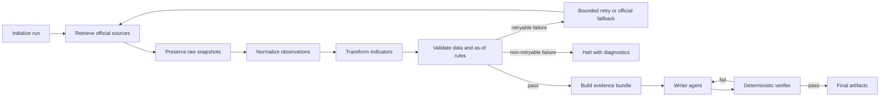

# Agent Implementation Plan

**Project:** Singapore Housing Macro Data Agent  
**Scope:** Singapore private non-landed residential sale and rental markets  
**Last updated:** 1 October 2026

## 1. Objective

Build a reproducible LangGraph agent that retrieves official public data, preserves raw evidence, applies deterministic transformations, validates data quality and point-in-time constraints, and produces a concise analytical report whose numbers and claims can be traced to their sources.

The system is an evidence workflow, not a trained forecasting model. It identifies data that may be useful for predicting market changes but does not claim that its descriptive signals are forecasts or causal estimates.

## 2. Non-Goals

- Building a property-transaction database
- Training or evaluating a price-forecasting model
- Allowing an LLM to calculate indicators
- Allowing unrestricted web search during normal runs
- Replacing unavailable official data silently with third-party data
- Interpolating annual non-resident population into quarterly observations
- Treating quarterly non-resident employment change as population growth

## 3. Target Graph



## 4. Engineering Principles

1. Deterministic code retrieves, parses, transforms, and validates data.
2. The LLM receives only validated evidence and writes prose; it does not create facts.
3. Every value must be traceable to a source URL, raw snapshot, retrieval timestamp, and SHA-256 checksum.
4. Observation period, official release date, retrieval time, and reporting cut-off remain separate.
5. Retries are bounded and based on error type; schema drift is never handled by guessing.
6. A failed required source prevents the report from being presented as current.
7. Each workflow run is immutable and resumable.

## 5. Implementation Phases

### Phase 0 — Freeze research scope

- [x] Define the property scope as private non-landed residential.
- [x] Separate the sale and rental markets.
- [x] Select URA non-landed price and rental indices as benchmarks.
- [x] Select the five conceptual predictors.
- [x] Document the literature-supported mechanisms and limitations.
- [x] Keep population and employment as separate measures.

**Exit criterion:** The agent does not reconsider the research scope or predictor set during normal runs.

### Phase 1 — Source catalogue and access spike

- [x] Define stable `source_id` values.
- [x] Record official pages and machine-readable endpoints.
- [x] Record exact series labels, selectors, units, and frequencies.
- [x] Test all eight source series against official endpoints.
- [x] Preserve successful and failed spike manifests.
- [x] Document direct SingStat failures and data.gov.sg mirrors.
- [x] Confirm MOM employment is report-based rather than a stable JSON series.

**Exit criterion:** Every required series has a verified official retrieval path or an explicit hard failure.

### Phase 2 — Agent foundation

- [x] Install project dependencies in `.venv`.
- [x] Compile and invoke a minimal LangGraph successfully.
- [x] Finalize the typed `AgentState` contract.
- [x] Add `run_id`, `reporting_as_of_date`, catalogue version, and prompt version to state.
- [x] Create an immutable per-run directory structure.
- [x] Add checkpoint/resume support.
- [x] Define terminal statuses: `complete`, `partial`, `blocked`, and `failed`.

**Required artifacts:**

```text
runs/<run_id>/
  raw/
  normalized/
  metrics/
  report/
  run_manifest.json
  validation_report.json
```

**Exit criterion:** A minimal compiled graph starts, checkpoints state, resumes, and terminates with a structured run status.

### Phase 3 — Live retrieval tools

- [x] Implement a data.gov.sg retrieval tool with pagination.
- [x] Implement the MOM final-report retrieval tool.
- [x] Restrict normal retrieval to approved official domains.
- [x] Add connect and read timeouts.
- [x] Add bounded retry for 429, 502, 503, and network timeouts.
- [x] Honour `Retry-After` when present.
- [x] Limit request concurrency to avoid public API quotas.
- [x] Save response content before parsing.
- [x] Record HTTP status, content type, retrieval time, byte count, and checksum.
- [x] Distinguish retryable network errors from non-retryable schema errors.
- [x] Never silently reuse an old snapshot as a new retrieval.

**Exit criterion:** A live run retrieves every source into a new run directory or returns explicit source-level diagnostics.

### Phase 4 — Normalization and transformation

- [x] Parse the data.gov.sg long-form URA benchmark format.
- [x] Parse the data.gov.sg wide SingStat-mirror format.
- [x] Parse current and previous non-resident employment changes from the MOM report.
- [x] Normalize annual, quarterly, and monthly period formats.
- [x] Preserve missing values as null rather than zero.
- [x] Calculate price-index and rental-index QoQ and YoY changes.
- [x] Calculate non-resident population YoY growth.
- [x] Calculate pipeline changes and under-construction share.
- [x] Derive private non-landed vacancy rate.
- [x] Select the final available monthly SORA observation in each quarter.
- [x] Mark incomplete SORA quarters.
- [x] Preserve GDP as official YoY growth and calculate the previous-quarter percentage-point change.
- [x] Write normalized and derived records into the current run directory.
- [x] Link each processed record to its source-run provenance.

**Exit criterion:** The same raw snapshot always produces the same normalized observations and metrics.

### Phase 5 — Quality gates and routing

- [x] Reject missing exact series labels.
- [x] Reject duplicate normalized series-period keys.
- [x] Reject ambiguous numeric strings.
- [x] Reject MOM reports released after the reporting cut-off.
- [x] Exclude observations whose period ends after the reporting cut-off.
- [x] Check unexpected unit changes.
- [x] Check invalid or missing periods.
- [x] Check zero denominators before derived rates.
- [x] Check record-count collapse and unexpected history truncation.
- [x] Add source-specific freshness rules.
- [x] Return `not_yet_released` separately from `failed`.
- [x] Route retryable failures to bounded retry.
- [x] Route schema drift and validation failures to human review.
- [x] Document the limitation when historical release vintages are unavailable.

**Exit criterion:** The report node is unreachable whenever a required quality gate fails.

### Phase 6 — Evidence bundle

- [x] Define a whitelist of reportable series.
- [x] Prevent calculation inputs and intermediate rows from entering the report.
- [x] Create one structured evidence object per reportable metric.
- [x] Attach source URL, raw checksum, period, unit, derivation, and limitation.
- [x] Attach the literature-supported mechanism separately from the current value.
- [x] Classify evidence as `shared`, `rent`, or `sale`.
- [x] Record whether the value is complete, provisional, stale, or unavailable.

**Exit criterion:** The evidence bundle alone is sufficient to reproduce and verify every quantitative report statement.

### Phase 7 — Writer agent

- [x] Select the LLM provider through configuration rather than hard-coding it.
- [x] Define structured writer input and output schemas.
- [x] Provide only the validated evidence bundle and approved literature notes.
- [x] Require separate shared, rental, and sale sections.
- [x] Prohibit unsupported numbers, causal language, and model-forecast claims.
- [x] Require explicit discussion of data limitations.
- [x] Record model name, prompt version, token usage, and response timestamp.
- [x] Provide a deterministic no-LLM report fallback.

**Exit criterion:** Replacing or disabling the LLM does not change any underlying value or validation outcome.

### Phase 8 — Verification agent and claim ledger

- [x] Parse every quantitative claim from the draft.
- [x] Match every reported value, unit, and period to the evidence bundle.
- [x] Verify that every citation maps to the correct official source.
- [x] Detect population/employment confusion.
- [x] Detect sale/rent mechanism confusion.
- [x] Detect missing incomplete-quarter or stale-data disclosures.
- [x] Detect unsupported causal or forecasting language.
- [x] Allow a bounded writer revision loop.
- [x] Halt after the maximum revision count rather than loop indefinitely.
- [x] Produce a machine-readable claim ledger.

**Exit criterion:** The final report has zero unmatched quantitative claims and zero unsupported citations.

### Phase 9 — Evaluation and failure testing

- [x] Add basic adapter, transformation, and workflow-node unit tests.
- [x] Test the as-of-date rejection of a future MOM release.
- [x] Test incomplete-quarter SORA handling.
- [x] Add golden raw fixtures independent of live websites.
- [x] Test HTTP 429 and `Retry-After` handling.
- [x] Test HTTP 502/503 and timeout handling.
- [x] Test a missing or renamed series.
- [x] Test changed MOM report wording.
- [x] Test unit changes and duplicate periods.
- [x] Test `na`, zero denominator, and truncated history.
- [x] Test report-number mismatch detection.
- [x] Add one live integration test that is excluded from the default offline suite.

The first production-layer integration check on 1 October 2026 recorded an explicit MOM HTTP 403 diagnostic. A subsequent full live run on 2 October retrieved all eight official sources successfully, and the separate opt-in live smoke test passed.

**Exit criterion:** Both successful and expected-failure paths are covered, and live-source changes do not make the offline suite nondeterministic.

### Phase 10 — Submission packaging

- [x] Generate one complete sample run.
- [x] Include raw, normalized, metrics, manifest, validation, and report artifacts.
- [x] Add installation and run commands to the README.
- [x] Document architecture and design decisions.
- [x] Document known limitations and future extensions.
- [x] Verify that no API keys, credentials, caches, or personal files are committed.
- [x] Run the complete offline test suite from a clean environment.
- [x] Review the repository as an interviewer would.

**Exit criterion:** A reviewer can clone the repository, run the documented command, inspect the evidence chain, and understand all material design choices.

## 6. Immediate Next Work Session

Complete these tasks in order:

All planned implementation phases are complete. Future work should start from the extensions in `docs/limitations.md` rather than changing the frozen take-home scope.

## 7. Definition of Done

The agent is complete only when all of the following are true:

- [x] A fresh live run succeeds through a compiled LangGraph.
- [x] Every required official source is retrieved or explicitly marked unavailable.
- [x] Raw responses and checksums are preserved.
- [x] All normalized and derived values pass validation.
- [x] As-of and release-date rules are enforced.
- [x] The Writer Agent receives only validated evidence.
- [x] Every quantitative claim passes deterministic verification.
- [x] The run can be resumed without repeating successful work.
- [x] Failure cases terminate cleanly without fabricated output.
- [x] The repository passes its offline tests from a clean environment.
- [x] The final report clearly distinguishes shared, rent-specific, and sale-specific mechanisms.

## 8. Progress Rule

At the end of each implementation session:

1. Update the checkboxes in this file.
2. Record any design decision that changes the graph or data contract.
3. Run the relevant tests.
4. Do not mark a phase complete until its exit criterion is satisfied.
5. Start the next session from the first unchecked item in the earliest incomplete phase.
