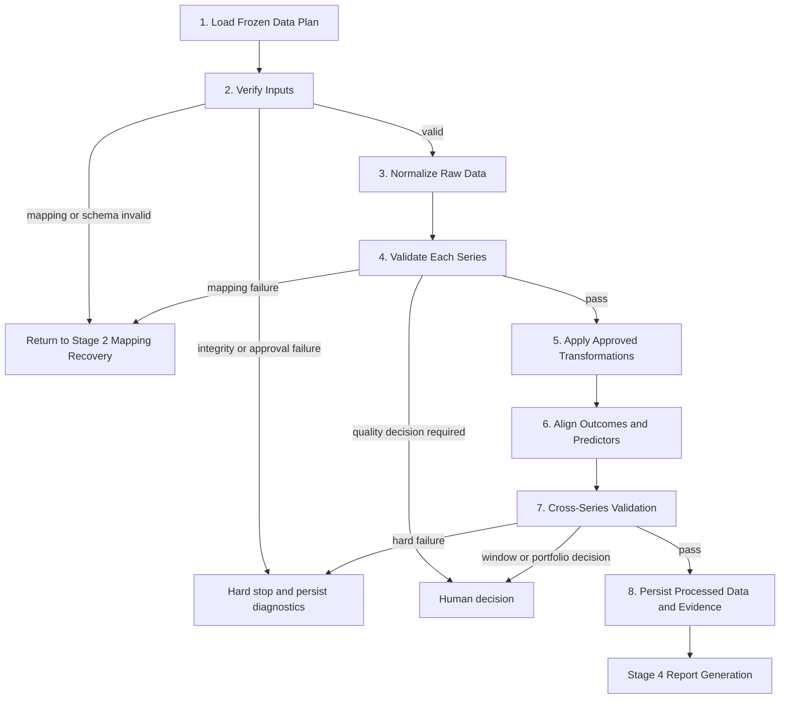

# Stage 3 — Deterministic Data Processing Plan

## Purpose and boundary

Stage 3 begins only after the user has confirmed the data presentation and preparation choices in Stage 2. It does not ask an LLM to reinterpret the data. It executes a frozen, human-approved data plan so that every number is reproducible and every failure has an explicit recovery route.



## Frozen inputs

The `FrozenDataPlan` must contain:

- a stable plan ID, version, content hash, approval status, reviewer and approval time;
- reporting as-of date and confirmed historical window;
- one approved source, immutable raw snapshot path and SHA-256 per series;
- one approved Mapping Contract and Preparation Contract per series;
- the series type, outcome/predictor role, and sale/rent/shared market role;
- explicit duplicate, missing-value, incomplete-period and release-availability policies.

Any semantic change creates a new plan version and invalidates downstream checkpoints.

## Ordered execution

### 1. Load and verify the frozen plan

Validate the plan version, approval, content hash, source IDs, snapshot existence and checksums, complete contracts, confirmed time window, and required sale/rent outcomes. A checksum or approval-integrity failure is a hard stop. A mapping mismatch returns to Stage 2. A missing source returns to data discovery.

### 2. Normalize raw data

Use the Mapping Contract to read JSON, CSV, or Excel; select and flatten records; convert wide or long layouts; parse periods and decimals; map declared missing markers to null; apply only the approved unit scale; and emit canonical observations with raw-record lineage.

Normalization means structural standardization, not statistical standardization. It must not impute values, infer unknown fields, calculate changes, aggregate frequencies, or alter the economic meaning of a unit.

### 3. Validate each series

Check required fields, numeric parsing, calendar-valid periods, duplicates, continuity, unit and frequency consistency, missingness, observation counts, raw-to-normalized reconciliation, as-of eligibility, incomplete periods, and freshness.

Observations after the as-of date remain in normalized artifacts with `after_as_of` status but are excluded from calculations. Missing values remain null. Unexplained duplicates are hard errors.

### 4. Apply approved transformations

Preserve every native-frequency series. Execute only transformations in the approved Preparation Contract:

- monthly-to-quarterly mean, last, or sum subject to series-type constraints;
- absolute, percentage, percentage-point, or basis-point changes;
- MoM, QoQ, and YoY using genuine calendar predecessors;
- calendar lags that retain original period, shifted period, lag count, rationale, and lineage.

### 5. Align outcomes and predictors

Find the common eligible window and align by actual calendar period. Produce separate sale and rent analytical datasets, a native-frequency monitoring dataset, and a structural-context dataset. Annual context must never be interpolated into quarterly observations.

### 6. Cross-series validation

Validate common coverage, outcome alignment, market roles, release availability and look-ahead risk, lagged coverage, latest-period completeness, accidental annual expansion, feature redundancy, confirmed window, and usable sample size.

### 7. Persist artifacts and evidence

```text
outputs/<run_id>/
├── normalized/
│   ├── observations.json
│   ├── observations.csv
│   └── excluded_observations.json
├── transformed/
│   ├── native_views.json
│   ├── native_frequency_monitoring.json
│   ├── structural_context.json
│   ├── quarterly_views.json
│   ├── changes.json
│   ├── sale_dataset.json
│   └── rent_dataset.json
├── validation/
│   ├── series_validation.json
│   ├── cross_series_validation.json
│   └── warnings.json
├── lineage/
│   └── transformation_trace.json
└── evidence/
    └── validated_evidence_bundle.json
```

Stage 4 may read only `validated_evidence_bundle.json`; it may not recalculate figures from raw files.

## Recovery routes

| Failure class | Examples | Route |
|---|---|---|
| Mapping | records path missing, renamed field, changed sheet | Stage 2 Mapping Recovery |
| Discovery | approved predictor has no snapshot | Data Discovery |
| Human approval | preparation choice or historical window missing | Human Review |
| Data quality | stale series, short common window, incomplete period | approved rule or Human Review |
| Integrity/program | checksum mismatch, altered plan, unexplained duplicate, illegal arithmetic | hard stop with diagnostics |

Stage 3 itself has no LLM retry loop. Each deterministic step executes once. Mapping recovery belongs to Stage 2 and is bounded to three mapping attempts per snapshot, three representations per source, and two official source candidates.

## Checkpoints

The workflow records `normalized`, `series_validated`, `transformed`, and `cross_series_validated` checkpoints. A report failure can resume from the last checkpoint. Reapproval of a Mapping Contract invalidates all later checkpoints for the affected run.

## Implementation sequence and test gate

- [x] Define `FrozenDataPlan` and contract models.
- [x] Define `CanonicalObservation` with exact decimal values and lineage.
- [x] Implement plan, approval, snapshot and checksum verification.
- [x] Implement JSON/CSV/Excel normalization for long and wide layouts.
- [x] Implement per-series validation and recovery classification.
- [x] Implement approved aggregation functions.
- [x] Implement approved change functions with calendar continuity.
- [x] Implement calendar lag with traceability.
- [x] Implement sale/rent alignment and context separation.
- [x] Implement cross-series validation.
- [x] Persist transformation lineage.
- [x] Implement deterministic checkpoints and invalidation rules.
- [x] Generate the validated evidence bundle.
- [x] Route every failure explicitly.
- [x] Add unit, integration, edge-case and repeatability tests.

## Running the stage

Stage 2 must first write an approved `frozen_data_plan.json`. Stage 3 can then be run from
the repository root without an LLM key:

```bash
.venv/bin/python scripts/run_stage3_processing.py \
  --plan outputs/<review_run>/frozen_data_plan.json \
  --output outputs/<stage3_run>
```

Exit code `0` means the validated evidence bundle was produced. Exit code `1` means the
JSON result and `validation/diagnostics.json` identify the required recovery route. The
command never retries calculations until they pass.

## Definition of done

Given the same Frozen Data Plan and identical raw snapshots, repeated runs must produce byte-identical normalized data, transformed results, validation results, lineage and validated evidence bundles. No report is produced after a hard error or unresolved human decision.
