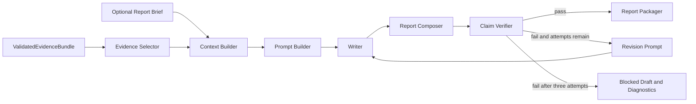

# Stage 4: Evidence-Bound Report Generation

## Objective

Stage 4 converts the immutable `ValidatedEvidenceBundle` produced by Stage 3 into a
concise, auditable analytical report. Code controls what the report may claim. An optional
LLM controls only how validated qualitative signals are explained.

The stage never retrieves data, remaps a source, changes a transformation, or calculates a
new statistic. Any such change must return to the appropriate earlier workflow stage.

## Boundary

Stage 4 may start only when:

- Stage 3 completed successfully;
- the evidence bundle passes its Pydantic contract;
- cross-series validation did not fail; and
- the reporting as-of date is present.

Stage 4 succeeds only when the final Markdown and its claim ledger pass deterministic
verification. An unverified draft is never labelled final.

## Subgraph



## Deterministic evidence selection

For each reportable series, the selector takes the latest eligible, non-null observation.
It excludes predictive-lag views because their period is an outcome-alignment period rather
than the source observation period. It retains approved levels, quarterly comparison views,
and changes as separate claims. Claim identifiers are stable for identical evidence.

Each selected claim retains:

- series and source identifiers;
- label, market role, and portfolio role;
- value, unit, period, and observation frequency;
- derivation and input periods where applicable;
- raw snapshot checksum and raw-record reference; and
- any applicable data-quality disclosure.

## Report context and prompt

The context builder combines selected evidence with an optional human-approved report brief.
The brief may contain scope wording, the user objective, predictor mechanisms, literature
references, source-page records, and reporting preferences. It cannot add quantitative
evidence. When a compiled `MemorySnapshot` and `FrozenDataPlan` are supplied, a deterministic
bridge carries the confirmed scope, report style, and predictor-selection rationales into the
brief. The plan maps memory predictor IDs to the final source and series IDs; memory never
overrides evidence values.

The prompt instructs the writer to:

- distinguish sale, rent, and shared signals;
- distinguish observed evidence from interpretation;
- discuss agreement, conflict, and insufficiency;
- avoid new calculations, numerical claims, causal claims, and forecasts;
- retain limitations and the reporting as-of boundary; and
- return the required Markdown headings.

The prompt text, prompt version, evidence checksum, provider, model, and response metadata
are persisted.

## Numeric claims and report composition

All numerical sentences and tables are rendered deterministically from selected claims. The
LLM-written section is qualitative and cannot introduce numbers. This makes value, unit,
period, source, lineage, and incomplete-period verification exact rather than probabilistic.

The final report contains:

1. executive summary and qualitative interpretation;
2. scope, method, and information cut-off;
3. deterministic validated-evidence tables;
4. data-quality and limitation disclosures;
5. source records; and
6. a statement that the output is an indicator-monitoring report, not a forecasting model.

## Verification and recovery

Deterministic verification checks:

- every claim marker occurs exactly once;
- every rendered value, unit, period, source ID, and lineage matches the claim ledger;
- the ledger contains exactly the selected evidence;
- the as-of date and required sections are present;
- the qualitative narrative contains no numerical claims;
- prohibited causal and forecasting phrases are absent;
- sale, rent, and shared headings are present; and
- material quality disclosures are included.

On failure, the writer receives only the verifier errors and the already approved context.
The complete draft may be revised at most three times. Continued failure produces a blocked
draft and machine-readable diagnostics for human review.

## Artifacts

```text
report/
├── final_report.md                 # only after verification passes
├── blocked_report.md               # only after bounded failure
├── selected_evidence.json
├── report_context.json
├── report_prompt.txt
├── report_prompt_manifest.json
├── prompts/                         # every bounded draft prompt
├── claim_ledger.json
├── verification_report.json
├── source_register.json
├── writer_metadata.json
└── run_manifest.json
```

## Acceptance tests

- consume the Stage 3 bundle directly;
- reject an altered value, unit, period, or source;
- reject unledgered numeric prose;
- reject unsupported causal or forecasting language;
- preserve sale/rent/shared distinctions;
- disclose incomplete or excluded evidence and as-of limitations;
- stop after three failed drafts;
- produce a deterministic no-key fallback report; and
- complete a Stage 3 to Stage 4 integration test without reading raw data.
